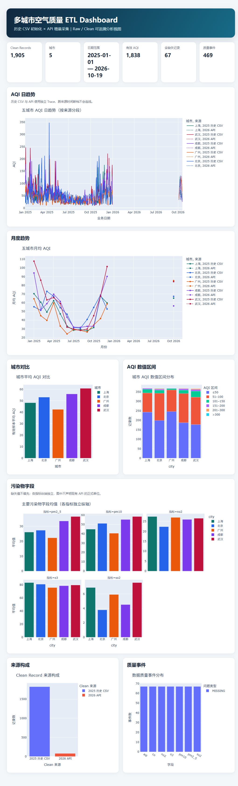

# 多城市空气质量 ETL Pipeline

项目使用 2025 年历史 CSV 初始化北京、上海、广州、成都、武汉的数据，并通过公开空气质量接口采集后续增量，经 MySQL Raw、Clean 和质量处理形成可追溯、可重复执行的数据链路。

## 核心能力

- **API 数据采集**：限制目标域名、城市白名单、超时和响应大小，只有传入 `--execute` 才会联网。
- **历史数据初始化**：校验 QuotSoft 全国城市小时 CSV，提取五城市并转换为日粒度记录。
- **可追溯 Raw 层**：区分历史 CSV 与 API 来源，保留来源键、观测小时、文件名、批次和 SHA-256。
- **ETL 与质量处理**：按 UTC+08:00 解析 `/Date(...)/`，统一污染物字段，识别缺失和越界值。
- **MySQL 幂等存储**：Raw 层按来源键 Upsert，Clean 层按 `(city, business_date)` Upsert。
- **增量合并**：API 数据优先于历史 CSV，并报告新增、重叠、来源变化和未变化业务键。
- **可视化交付**：输出来源分段日趋势、月度趋势、城市/污染物对比、AQI 区间、来源构成和质量事件 Dashboard。
- **自动化测试**：覆盖采集安全边界、Hash、日期解析、质量规则和报告生成。

## 数据流

```text
历史 CSV → 校验与日粒度转换 ┐
                              ├→ MySQL Raw → Clean + Quality Log
CNEMC API → Raw JSON + Manifest ┘
```

## 结果展示

下图由实际 MySQL 数据生成，包含 1,905 条五城市日粒度记录，覆盖 AQI 趋势、月度变化、城市与污染物对比、数据来源和质量问题。



## 快速开始

```powershell
py -3.12 -m venv .venv
.\.venv\Scripts\python.exe -m pip install -r requirements.txt
Copy-Item .env.example .env
```

在 `.env` 中填写项目 MySQL 账号。该账号需要对 `MYSQL_DATABASE` 中的项目自有表具备 `CREATE / SELECT / INSERT / UPDATE` 权限。

```powershell
# 创建缺失的项目表，不执行 DROP
.\.venv\Scripts\python.exe -m scripts.main init

# 采集五城市；真实 Raw 数据保存在 Git 忽略目录
.\.venv\Scripts\python.exe -m scripts.main collect --execute --cities 110000 310000 440100 510100 420100

# 每个 Snapshot 批次分别导入 Raw 层
.\.venv\Scripts\python.exe -m scripts.main load --batch-dir data\raw\<batch_id>

# 历史 CSV 先只读验证，再导入 Raw
.\.venv\Scripts\python.exe -m scripts.main validate-history --input-dir data\raw\history_csv\incoming
.\.venv\Scripts\python.exe -m scripts.main load-history --input-dir data\raw\history_csv\incoming

# 指定历史批次执行 Raw → Clean
.\.venv\Scripts\python.exe -m scripts.main run --batch-id history-csv-20250101-20251231

.\.venv\Scripts\python.exe -m scripts.main run
.\.venv\Scripts\python.exe -m scripts.main report --output-dir outputs\latest
```

已有旧版 `raw_air_quality` 的数据库必须先备份，并在明确授权后执行
`sql/migrations/001_add_raw_source_provenance.sql`；`init` 只创建缺失表，不会自动迁移现有表。

没有可写 MySQL 时，可以从 Snapshot 生成只读预览：

```powershell
.\.venv\Scripts\python.exe -m scripts.main preview --batch-dirs data\raw\<batch_1> data\raw\<batch_2> --output-dir outputs\preview
```

## 测试

```powershell
$env:TEMP=(Resolve-Path runtime\tmp).Path
$env:TMP=$env:TEMP
.\.venv\Scripts\python.exe -m pytest -q
```

## 运行结果

项目已在本地 MySQL 8.0.44 上完成全流程运行：2025 年历史 CSV 为五个城市生成了 1,825 条日记录，后续 API 数据将总量扩展到 1,905 条。相同批次重复导入后，Raw、Clean、业务唯一键和质量事件数量保持不变。

最终数据覆盖 `2025-01-01` 至 `2026-10-19`。Dashboard 与月度汇总均由这批实际数据生成，月度记录数合计与 Clean 层一致；桌面和窄屏页面也完成了浏览器检查。当前自动化测试结果为 `34 passed`，详细结果见 [验证记录](docs/validation.md)。

历史 CSV 的字段单位按 QuotSoft 数据说明解释。由于现有 API 没有可靠的字段字典，Dashboard 不标注污染物浓度单位。

## 安全与数据边界

- `.env`、真实 Raw JSON、运行输出和本地虚拟环境不提交 Git。
- 项目只创建缺失的自有表，不执行 `DROP TABLE`，ETL 不修改 Raw 层。
- 测试样例与真实采集数据分开保存。

更多信息见 [项目设计](docs/spec.md)、[实施计划](docs/plan.md)、[数据来源](docs/source-baseline.md) 和 [验证记录](docs/validation.md)。
